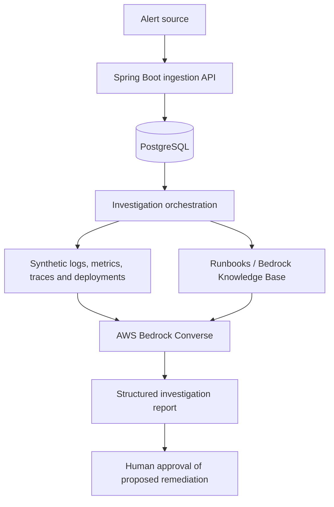

# Architecture

## Goal

IncidentLens AI is an AI-assisted incident investigation platform designed to help engineers diagnose production
incidents in distributed backend systems.

It correlates alerts, logs, metrics, distributed traces, deployment events and operational runbooks across services to
identify probable root causes, generate evidence-grounded incident reports and recommend remediation actions subject to
human approval.

IncidentLens AI itself is a modular monolith; the environment it investigates is a distributed system. The MVP uses
simulated distributed-system telemetry rather than requiring a fully deployed microservices environment. Operational
evidence providers should support future integration with real observability platforms without speculative abstractions.

## Current implementation

Java 21 / Spring Boot 4.0.9 modular monolith; Maven, Spring Data JPA, PostgreSQL and Flyway. Local PostgreSQL runs via
Docker Compose. Feature packages separate API, service, domain and persistence concerns.

- Incident: UUID, OPEN/RESOLVED status, severity and timestamps.
- Alert: UUID, incident foreign key, source, service, alert type, severity, message, optional occurrence time and server
  receipt time.
- Many alerts may belong to one incident. Alert references Incident with a lazy many-to-one relationship; persistence is
  explicit.
- `AlertIngestionService.ingest` saves a new incident and alert within one transaction and returns the incident ID.
  Currently one incident is created per alert.
- Flyway owns schema evolution; applied migrations are immutable.

## Target MVP flow (planned)

The application owns incident state, evidence retrieval, validation and approval. Bedrock assists reasoning, not
authoritative state changes. Evidence references, uncertainty and missing evidence must be visible in reports. Model
output is untrusted; validate it before use. Approval is recorded by the application; the MVP need not execute real
remediation.

## Decisions and tradeoffs

- Modular monolith first: simpler delivery and transactions; split services only if justified later.
- PostgreSQL as durable state; no additional messaging or caching infrastructure for the MVP.
- Start with synchronous HTTP ingestion; keep external AI calls outside ingestion transactions.
- Use realistic synthetic operational evidence (logs, metrics, distributed traces and deployment events) to simulate
  incidents across distributed services for the MVP.
- Reuse the previously implemented AWS Bedrock Knowledge Base (`incidentlens-operational-kb`, previously in
  `eu-north-1`) for retrieving operational runbooks, troubleshooting procedures and service architecture documentation,
  after verifying its availability and relevance.
- Keep incident-specific operational evidence separate from static knowledge retrieved through RAG. Historical examples
  in runbooks are not evidence of a current incident. The investigation and AI integration are real; the MVP telemetry
  is simulated.
- Planned correlation: match service and alert type within a defined window; attach to an OPEN incident or consider
  reopening a recently resolved incident (initial proposal: two minutes). Finalize semantics and concurrency safeguards
  before implementation.
- Planned idempotency: define a stable source event identifier and enforce uniqueness atomically; test duplicate
  delivery and concurrent requests. Do not confuse deduplication with correlation.
- Use bounded AI requests, explicit timeouts, safe error handling and cost-conscious AWS configuration.
